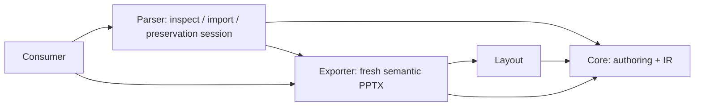

# ADR 0001 — Parser-owned import and preservation saves

Status: **Accepted architecture decision; structural import/no-op runtime implemented, semantic/edit/rebuild conformance pending.**

Scope: IMP-01. The [public structural session](../../api/import-session.md) now implements explicit structural projection, original-byte no-op preparation/save and lifecycle/resource checks. The [checked workflow](../../examples/import-save-contract.ts) imports actual public types. This does not establish complete semantic import, edit-save or rebuild conformance; IMP-01 stays open for those remaining gates.

## Problem

Export currently consumes a format-independent document and writes a new PPTX package. Import must also retain information that has no Core representation: unknown parts, relationship closures, source identities, extension ordering and inheritance provenance. Passing that information through ordinary Core elements would tie all renderers and authoring operations to OOXML. Discarding it would make preservation-aware saves impossible.

The boundary must distinguish a new export, unchanged-source save, supported editing and explicitly lossy rebuilding. It must also prevent source handles, stale plans and generic loss consent from being reused against unrelated documents.

## Decision and ownership

The `@pptkit/pptx-parser` package owns inspection, supported semantic import, source state, and preservation-save orchestration. Its cohesive responsibility is the lifecycle of an imported format document. The existing exporter remains the fresh-package writer and has no knowledge of live import sessions.

Dependencies are one-way:

The Parser → Exporter edge is used only for semantic rebuild through the public `generatePptx` entry. Exporter must not import Parser, its source state or its private modules. Preservation serialization and relationship reconciliation stay in Parser; it must not patch opaque output using exporter internals or global string replacement.

No shared format package is introduced now. If real implementations later demonstrate duplicate ZIP/OPC infrastructure with a stable public responsibility, a separate ADR can define that boundary. A hypothetical need does not justify a registry, broad abstract format layer or element-specific packages. Existing `fflate` use in Exporter is an implementation detail, not permission to import its private ZIP writer.

Core/Canonical IR contain no XML, ZIP bytes, relationship IDs, preservation handles or live session references. Renderer only receives supported Layout semantics and ordinary diagnostics. Missing preview semantics remain visible in capability reports; preserved SmartArt is not converted into an editable SmartArt claim.

## Public workflow to implement

1. `inspectPptx(bytes, options)` inspects a detached byte snapshot under explicit resource budgets. Its current [structural profile](../../api/pptx-inspection.md) returns ordering, dimensions, source references and unresolved-inheritance findings; complete per-feature capability diagnostics remain pending. It does not execute content, resolve remote relationships or create a mutable authoring session.
2. `importPptx(bytes, options)` validates the supported package envelope, construct a valid Core document (currently an explicit structural projection), capture its baseline normalized snapshot and return an `ImportedPresentation` session with a readonly report. Incomplete semantic conversion is permitted only when classified and safely retained or explicitly rejected; corrupt/incomplete package inspection never masquerades as successful preservation.
3. `session.document` is the editable authoring document. Its reference cannot be replaced. Supported authoring edits remain Core operations.
4. `session.prepareSave({ mode })` captures a candidate document snapshot, detect changes, reconcile source ownership, resolve explicit resources, serialize and verify candidate bytes under output budgets. It returns either a ready opaque plan or a blocked report. It exposes no output bytes before the caller has reviewed required losses.
5. `session.save(plan, { acceptLossIds? })` verifies session/plan identity, liveness, current document equality to the planned snapshot and exact loss consent, then return a detached copy of the prepared bytes and report. It performs no filesystem writes or new asset fetching.
6. The caller writes/downloads the returned bytes. Filesystem overwrite/atomic-write policy belongs to a Node adapter or application, not the preservation engine.

The byte API accepts `Uint8Array`, not filenames, URLs or caller-owned ZIP/XML objects. Import detaches source bytes at invocation before asynchronous work can observe caller mutation. Caller asset resolvers, if introduced, are explicit options with cancellation and budgets; external references are not fetched simply because they appear in relationships.

## Save mode contract

| Operation | Input and permitted behavior | Failure/loss policy | Assurance |
| --- | --- | --- | --- |
| Existing `generatePptx(document)` | Fresh semantic export, including authoring documents created without import | Existing exporter semantics; has no source preservation state | Fresh export only |
| `mode: "no-op"` | Session document equals the captured import baseline; returns original source bytes after envelope validation | Any semantic change blocks preparation. No fallback to edit or rebuild. No loss consent can bypass this condition | `original-bytes` |
| `mode: "edit"` | Supported semantic changes, source-identity reconciliation and validated preservation closure | Untouched opaque regions remain intact. Invalidated structures must either block or appear as specific losses before a ready plan is exposed | `scoped-preservation` |
| `mode: "rebuild"` | New export of the supported semantic projection using the public exporter | Every omitted source feature/dependency must appear in the plan's losses; never treated as round-trip | `semantic-rebuild` |

Mode is mandatory. No generic `save`, automatic fallback, `allowLossy: true`, or boolean “supported PPTX” promise is accepted. Selecting rebuild is not itself consent to its losses. Calling the existing exporter directly on `session.document` is possible and deliberately remains a **fresh semantic export**; the exporter cannot infer absent source state. Documentation and examples must direct preservation consumers to the session workflow.

Original byte equality does not prove a digital signature is valid, trusted or unexpired. No-op does not claim to verify signatures or execute embedded content. Encrypted, macro-enabled, signed or other specialized containers require explicit recognition/policy in IMP-02/ADV-11/ADV-12; arbitrary files must not be copied through a purported successful PPTX session. Initial implementation will publish its accepted content-type subset rather than infer it from a filename extension.

## Reports, identity and capability tiers

A source reference identifies the canonical part and optional source path/object/relationship identity. It is provenance, not an editable raw XML fragment. A Core ID maps to source identity records; one-to-many mappings are allowed where normalization combines or expands structures. Presentation/layout/asset identities are tracked separately from drawing object identities.

Capabilities are reported per feature **and operation**: create, import, edit, preview, export, no-op save and edit save. Each finding is `editable`, `preserved`, `fallback` or `unsupported`, with source identity and reason. The same diagram can be preserved for saving and unsupported for editing. Missing inventory evidence is not silently interpreted as preserved.

Every reported loss has a stable ID within its plan, feature, source location when one exists, impact, reason and possible alternative. Newly authored content without a source part uses its Core slide/element identity. The runtime must validate that a finding can be located; it must not invent source paths for new objects. Reports are deeply detached/read-only; callers cannot mutate a report to authorize different bytes.

The full source relationship closure, retained parts and XML provenance remain private to the session. Public reports expose inventory/provenance metadata, not a mutable serialization graph. Source bytes are not exposed by ordinary getters. A document clone or a document serialized to JSON loses preservation context and cannot manufacture a valid imported session.

## Source/session/plan lifetime

- Sessions hold an immutable source byte snapshot, inspected package graph, source-to-Core identities and baseline normalized document. The source baseline never advances implicitly after saving.
- Prepared plans bind a session identity, source baseline, immutable candidate document snapshot, inspected loss set and verified candidate bytes. Plans cannot be moved between sessions even if documents have equal IDs or contents.
- Compile-time branding discourages forged plans; runtime ownership/liveness checks are still mandatory. Type assertions cannot bypass them.
- `prepareSave` is asynchronous. If the document changes before preparation finishes, preparation returns blocked with `save-snapshot-stale`; it does not expose a plan that silently refers to older content.
- `save` checks the current normalized snapshot against the plan snapshot. Until incremental edits have a proven revision contract, use full normalized structural equality rather than relying solely on a caller counter or hash collision assumptions.
- Two plans prepared from the same unchanged snapshot may both remain valid. Successful `save` does not mutate the session/document or consume the plan; retries return detached equivalent bytes. An invalid consent attempt does not invalidate an otherwise valid plan.
- `plan.dispose()` releases candidate output and is idempotent. `session.dispose()` releases source state and all its plans; it is idempotent. Outstanding asynchronous work must fail without returning usable bytes/plans after disposal.
- The already returned Core document remains a valid independent authoring document after disposal, but cannot be used for preservation saves. Any previously returned byte array stays caller-owned.
- Neither sessions nor plans are serializable preservation formats. JSON serialization must fail clearly, and worker/process transfer requires re-importing source bytes. Durable checkpoints are deferred until a separately versioned format and validation policy exists.

Cancellation during import or preparation releases partial state, yields no successful result and leaves any existing session/document intact. There is no automatic plan/source rebasing after a successful save; re-importing output creates a new, independently validated baseline.

## Review and loss consent

Preparation does the expensive and failure-prone work **before** loss consent: resolve supported assets, reconcile references, serialize, inspect the result and compute all losses. This avoids discovering unapproved losses after the application has reviewed a plan. Candidate bytes remain private until save succeeds.

`acceptLossIds` must match exactly the required losses of that live plan. Missing, foreign, duplicate or stale IDs fail without bytes. Loss-free plans require no consent. Fatal package errors, unavailable required assets, invalid Core state, unresolved preservation dependencies and unsupported output container policy are blocked conditions, not losses that can be approved away. A caller can edit the document/policy and prepare again.

Example loss scopes include an explicitly removed unsupported diagram closure, a dropped effect on a modified supported shape, or source objects omitted by semantic rebuild. A broad “unknown features may be lost” message is insufficient; preparation must enumerate affected source identities and dependency closures, or block if it cannot determine them.

## Errors and atomicity

Expected unsupported edits return `status: "blocked"` with diagnostics and no usable plan. Fatal input corruption/resource exhaustion, cancellation and invalid lifecycle/consent use typed error codes. The runtime error family includes `import-invalid-package`, `import-limit-exceeded`, `operation-aborted`, `session-disposed`, `plan-disposed`, `plan-session-mismatch`, `save-snapshot-stale`, `save-loss-consent-mismatch` and `session-not-serializable`.

No failed operation mutates the document, source graph, baseline, existing valid plans or caller bytes. Diagnostics retain useful part/path and Core identity. Errors never expose partial output as successful bytes. Save verification checks package relationships/content types, referenced identities and declared preservation commitments; generating a syntactically valid ZIP is not sufficient.

## Bounded inspection requirements for IMP-02

All limits are validated finite positive integers before allocation (ratios may be positive finite numbers). Implement named budgets for compressed input bytes, actual expanded total and per-entry bytes, entry count, compression ratio, XML characters/nodes/depth, relationship count and prepared output bytes. Publish defaults with the inspector; any adjustment needs representative corpus/performance evidence.

Limits apply to actual decoded output and parsed structure, not only attacker-controlled ZIP sizes. Inspection checks duplicate/canonicalized paths, local/central header consistency, unsafe relationships, CRC, supported compression/container forms, malformed XML and missing targets. XML processing disables external entities and implicit retrieval. Unsupported encodings/dialects/compression forms must be rejected or explicitly classified before a session can promise preservation. These are implementation gates, not claims that the inspector currently exists.

## Rejected alternatives

- **Opaque XML on Core elements:** leaks format storage and source lifecycle into renderers and generic authoring APIs.
- **Exporter consuming Parser internals:** creates reverse dependencies or exposes mutable preservation graphs; source reconciliation belongs with the imported session.
- **Exporter calls Parser while Parser calls Exporter:** direct dependency cycle with unclear lifecycle ownership.
- **Source bytes in an untyped WeakMap keyed by arbitrary Core documents:** cloning, cross-session identity, serialization and save semantics become hidden global behavior.
- **Always regenerate then attach unknown parts:** unknown relationships and modified parent XML can be inconsistent even when ZIP entries are copied.
- **Hash-only freshness or generic loss consent:** may approve an unrelated/stale snapshot or a different loss set.
- **New shared package before the first parser:** no demonstrated stable responsibility yet; revisit only with real coupling evidence.

## Conformance gates and task mapping

| Gate | Required evidence | Owner/task |
| --- | --- | --- |
| Public import contract | Actual Node/browser package consumers import the public entry; valid input creates a detached document/report and session | IMP-01.1, IMP-02/03 |
| Byte snapshot and inspection limits | Mutate input during async work; malformed/oversized/corrupt ZIP/XML fixtures never create a usable session | IMP-02 |
| Identity/capability inventory | Known/unknown mixed documents map every finding to source identity with operation-specific tiers | IMP-03/04/07 |
| no-op | Baseline equality, exact original byte output, edited-document rejection, multiple producers reopening output | IMP-08 |
| Edit save | Supported edits plus unknown sibling/closure preservation; ref/ID collisions, deletion/copy, source detachment | IMP-09 |
| Loss consent | Missing/foreign/stale/duplicate consent, new preparation after changed document, unsupported fatal conditions cannot be approved | IMP-09.4 |
| Lifecycle/concurrency | Cross-session/forged/disposed plans, double dispose, cancellation, mid-prepare edits/disposal, repeated save and independent returned bytes | IMP-01 runtime seam, IMP-08/09 |
| Rebuild | Explicitly enumerated losses, public exporter call only, unavailable resource failure before consent, original session unchanged | IMP-09 |
| Architecture | No XML/ZIP in Core, no Parser import in Exporter, no private cross-package imports; installed browser/Node consumer tests | IMP-01.3 and package checks |

The public structural session has Node/browser conformance evidence for source snapshotting, frozen reports, plan branding/ownership, disposal, cancellation, exact original bytes, stale-state rejection and resource budgets. Default edit and all rebuild requests return blocked reports with no output assurance. The subsequent explicit [text-run profile in ADR 0008](0008-direct-text-preservation-save.md) implements a bounded loss-free edit path; complete per-object semantics, nonempty loss consent, structural reconciliation and rebuild remain pending. Keep IMP-01 and dependent parent tasks open until the complete gates above pass. Dependencies gate completion rather than exploratory implementation.
